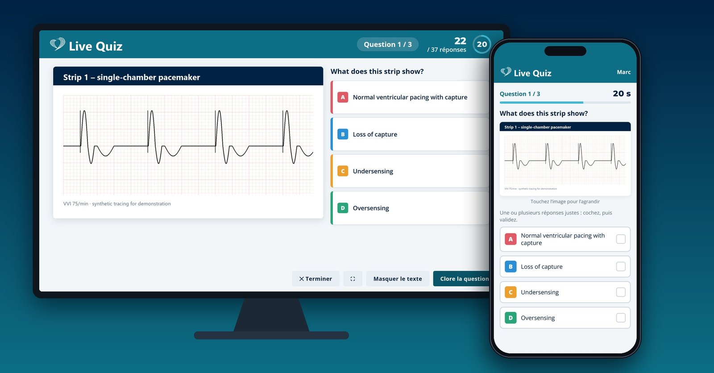
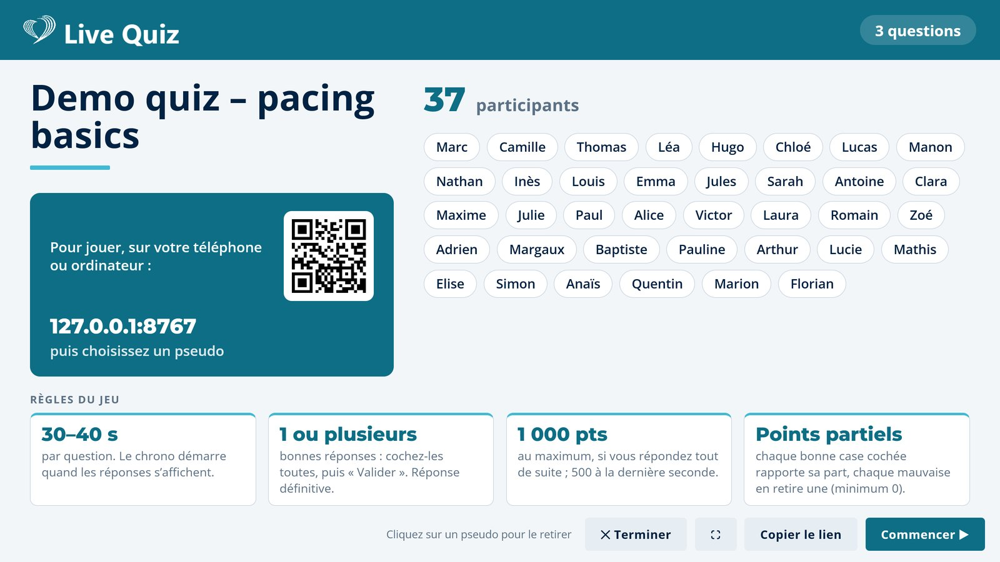
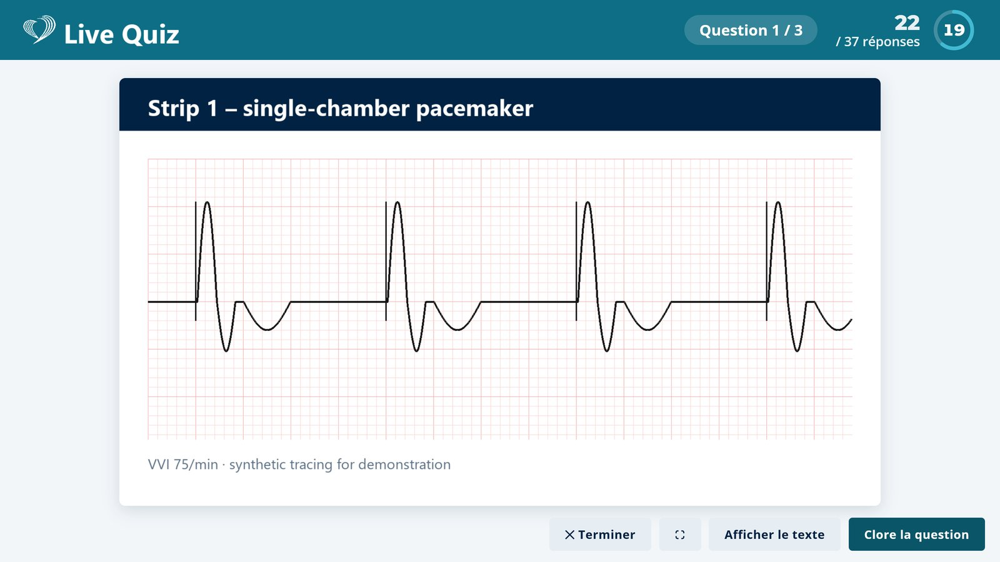

# Live Quiz

A free, self-hosted live quiz for teaching sessions over Zoom or in a lecture hall, like Kahoot but with **no participant limit and no time limit**. The question and its tracing go on the shared screen; everyone answers on their phone. No app, no account, no PIN.

Built with [Claude](https://claude.ai) for the live sessions of [Liryc Education](https://www.liryc-education.fr) (cardiac pacing and electrophysiology teaching). In use since November 2026, and tested with 100 simultaneous players on a shared hosting plan without a single error.



## Features

- **Players** open a link or scan a QR code, type a nickname and they are in. The question image can be zoomed on the phone.
- **Presenter screen** made for screen sharing (16:9, scales to any window): waiting room with QR code and nicknames, countdown, answer count, reveal with the number of players per answer, top-5 leaderboard after each question, podium with confetti, full ranking and CSV export.
- **Two kinds of quiz**: one correct answer per question (one tap answers, like Kahoot) or several correct answers with partial points.
- **Teaching tools**: an explanation slide shown at the reveal, a **Hide text** key (M) that enlarges an ECG or EGM to the full screen, and **Review questions** at the end to go back through every answer.
- **Control**: end the game at any time, remove a player, resume after reloading the presenter page.
- **Light and robust**: plain PHP and JavaScript, no database, no external service. Phones read the game state from a small static file, so a cheap server copes with 100+ players.

| Waiting room | Hide text (M): the tracing fills the screen |
|---|---|
|  |  |

> The interface is in **French** (it was built for French-speaking sessions). All texts are in `quiz/index.html`, `quiz/host.html`, `quiz/js/*.js` and `quiz/api.php`, so translating it is a good job to give Claude: *“translate the whole interface of this app into English”*.

## Install

You need web hosting with **PHP 7.4 or newer** and Apache (almost any shared hosting, or a folder on an existing website).

1. Download this repository (green **Code** button → **Download ZIP**) and unzip it.
2. In the `quiz` folder, copy `config.example.php` to `config.php` and fill in:
   - `ADMIN_PASSWORD_HASH`: the hash of your presenter password, generated with
     `php -r "echo password_hash('your-password', PASSWORD_DEFAULT), PHP_EOL;"`
     (no PHP on your computer? Ask Claude to explain how to generate it, or run it on your server.)
   - `SECRET`: any long random string, e.g. from `php -r "echo bin2hex(random_bytes(32)), PHP_EOL;"`
3. Upload the **contents** of the `quiz` folder to your server, for example to `www/quiz/` (FTP, SFTP or your host’s file manager). The `data/` and `live/` folders must be writable by PHP.
4. Open `https://your-site/quiz/host.html`, log in, and pick the **Demo quiz** to try it with a colleague’s phone.

To test on your own computer first: `cd quiz && php -S localhost:8000`, then open `http://localhost:8000/host.html`.

With [Claude Code](https://claude.com/claude-code) you can simply say *“install this quiz on my hosting”*, give it your FTP/SFTP details, and it does the steps above.

## Create a quiz with Claude

A quiz is one JSON file plus a folder of images in `quiz/quizzes/`. You do not need to write it by hand:

1. Open `quiz/guide.html` on your site (also linked from the presenter’s start page).
2. Copy the instructions it gives into a new conversation on [claude.ai](https://claude.ai), and attach your questions and answers (Word, PDF, PowerPoint, text…) and your images.
3. Claude returns a `.zip`. Drop the `.json` file into the checker at the bottom of `guide.html`: it flags errors and previews every question with its correct answer.
4. Upload `<id>.json` and the `<id>/` image folder to `quiz/quizzes/`. The quiz appears in the presenter’s list.

### Quiz format

```json
{
  "id": "demo",
  "title": "Demo quiz – pacing basics",
  "description": "Shown in the waiting room.",
  "cover": "quizzes/demo/cover.png",
  "time": 30,
  "scoring": "partial",
  "single": false,
  "questions": [
    {
      "q": "What does this strip show?",
      "img": "quizzes/demo/q02.png",
      "explain": "quizzes/demo/q02-explanation.png",
      "time": 30,
      "points": 1,
      "choices": [
        { "t": "Full answer text (phones)", "s": "Short version for the big screen (optional)", "ok": true },
        { "t": "Another answer", "ok": false }
      ]
    }
  ]
}
```

| Field | Meaning |
|---|---|
| `time` | Seconds to answer (quiz default, or per question). |
| `scoring` | `partial`: each correct box ticked earns its share, each wrong box ticked takes one away (minimum 0). `exact`: all or nothing. |
| `single` | `true`: one correct answer per question, one tap on the phone answers (use with `"scoring": "exact"`). |
| `points` | Multiplier: 2 = the question counts double. |
| `choices` | 2 to 6 answers: `t` text, `s` optional short version for the shared screen, `ok` correct or not. |
| `explain` | Optional explanation slide shown on the shared screen at the reveal (key E toggles it). |

Scoring: a correct answer earns 1,000 points if given instantly, decreasing to 500 at the last second, times `points`. Ties go to the faster player.

The `.json` files are never served to the web (`quizzes/.htaccess`), so players cannot read the answers.

## Running a session

1. Open `host.html` on your computer, log in, pick the quiz.
2. Share that window in Zoom (or project it) and press **F** for full screen. Players join with the link or the QR code.
3. **Space** or **→** moves on. Each question closes by itself when time is up or everyone has answered.
4. Keys: **M** hides the text so the image fills the screen, **E** switches between tracing and explanation slide. **✕ Terminer** ends the game at any time.
5. At the end: podium, full ranking, **Exporter (CSV)**, and **Revoir les questions** to go back through every answer.

Players should only ever be asked for a nickname. Never put identifiable patient data in quiz images.

## How it works

- `quiz/api.php` + `quiz/lib.php`: JSON API (join, answer, presenter actions). Storage is plain files: one file per player and per answer, created exclusively so simultaneous requests never collide, and a game state written atomically under a lock. No database, which also makes it safe on network file systems.
- `quiz/live/<game>.json`: the public game state, rewritten after each presenter action and read every second by phones as a static file (no PHP per poll). It never contains the correct answers before the reveal. `live/current.json` names the open game.
- `quiz/index.html` + `js/player.js`: the phone app. `quiz/host.html` + `js/host.js`: the presenter screen. `css/quiz.css`: one stylesheet; change the colours in `:root` and replace `img/logo.png` to apply your own branding.

Some hosts limit simultaneous requests coming from one IP address. That never affects real players (each phone has its own connection), but load-test from several machines rather than one.

## Licence

MIT: free to use, modify and share, including commercially. See [LICENSE](LICENSE). A credit and a link back are appreciated.
